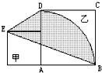

# Mathematics (Grade 6)

**ID**: 64fc49ea
**难度**: medium_hard
**题型**: short_answer

## 题目
如图，甲、乙都是正方形，甲的边长是10cm，乙的边长为12cm，求阴影部分的面积．(取π为3)

## 解答

**答案**: 113.04

1. Step1:明确梯形的上底为甲的边长10cm，下底为乙的边长12cm，高为甲的边长10cm，根据梯形面积公式S=(a + b)×h÷2，可得梯形面积为(10 + 12)×10÷2 = 110平方厘米
2. Step2:已知圆的半径为乙的边长12cm，根据圆的面积公式S = πr²，且阴影部分是圆面积的1/4，π取3，可得圆面积的1/4为3×12²÷4 = 108平方厘米
3. Step3:确定大的空白三角形的底为甲的边长与乙的边长之和10 + 12 = 22cm，高为甲的边长10cm，根据三角形面积公式S = a×h÷2，可得大的空白三角形面积为10×(10 + 12)÷2 = 110平方厘米
4. Step4:根据阴影部分的面积=梯形的面积+以12厘米为半径的圆的面积的1/4−大的空白的三角形的面积，将前面计算结果代入可得110 + 108 - 110 = 108平方厘米

## 知识点

**知识点**:
  - 组合图形的面积．

---
