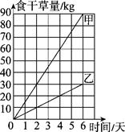

# Mathematics (Grade 6)

**ID**: 65cbf944
**难度**: medium_hard
**题型**: short_answer

## 题目
根据图象回答问题。
下图反映了黄牛和山羊食干草的情况。

(1)猜一猜，图中的两条线，哪一条反映的是黄牛食干草的情况？哪一条反映的是山羊食干草的情况？
(2)估计黄牛和山羊3天各食多少千克干草。
(3)30 kg干草黄牛可食用几天？山羊呢？

## 解答

**答案**: 甲反映的是黄牛食干草的情况，乙反映的是山羊食干草的情况。, 黄牛3天食45 kg干草，山羊3天食15 kg干草。, 30 kg干草黄牛可食用2天，山羊可食用6天。

1. Step1:观察图像，根据生活常识，通常黄牛食量大于山羊，图像中甲线对应的食量数值整体大于乙线，所以判断甲反映的是黄牛食干草的情况，乙反映的是山羊食干草的情况。
2. Step2:在图像中找到天数为3的位置，对应甲线的食量约为45kg，对应乙线的食量约为15kg，所以得出黄牛3天食45 kg干草，山羊3天食15 kg干草。
3. Step3:在图像中找到食量为30kg的位置，对应甲线的天数约为2天，对应乙线的天数约为6天，所以得出30 kg干草黄牛可食用2天，山羊可食用6天。

## 知识点

**知识点**:
  - 小学数学;数与代数;比和比例;比例

---
