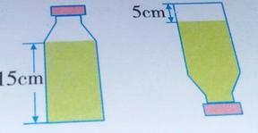

# Mathematics (Grade 6)

**ID**: 65e9f084
**难度**: medium_hard
**题型**: short_answer

## 题目
为了测量一个瓶子的容积，数学兴趣小组做了一个小实验，量得瓶子底面的内直径为 10cm，倒入一些水后，量得水深为15cm
  ，再把瓶盖拧紧倒放时，量得空余部分的高为 5cm，这个瓶子的容积是多少？

  15cm   5cm

## 解答

**答案**: 1570立方厘米

1. Step1:根据圆的直径公式d = 2r（d为直径，r为半径），已知瓶子底面内直径为10cm，可得底面半径r = 10÷2 = 5cm
2. Step2:根据圆柱体积公式V = πr²h（V为体积，r为底面半径，h为高），瓶子正放时水的部分是高为15cm的圆柱，倒放时空余部分是高为5cm的圆柱，那么瓶子的容积相当于底面半径为5cm，高为15 + 5 = 20cm的圆柱的体积
3. Step3:将半径r = 5cm，高h = 20cm，π取3.14代入圆柱体积公式V = πr²h，即V = 3.14×5²×20 = 3.14×25×20 = 1570立方厘米

## 知识点

**知识点**:
  - 

---
