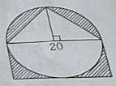

# Mathematics (Grade 6)

**ID**: 66119eea
**难度**: medium_hard
**题型**: short_answer

## 题目
求图中阴影部分的面积.(单位：cm)

 20

## 解答

**答案**: 100

1. Step1:计算圆的半径，20÷2=10(cm)
2. Step2:计算长方形面积，10×20=200(平方厘米)
3. Step3:计算半圆面积，3.14×10×10÷2=157(平方厘米)
4. Step4:计算空白三角形面积，20×10÷2=100(平方厘米)
5. Step5:计算阴影面积，200 + 157 - 157 - 100 = 100(平方厘米)

## 知识点

**知识点**:
  - --

---
