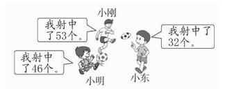

# Mathematics (Grade 6)

**ID**: 6667d426
**难度**: medium_hard
**题型**: short_answer

## 题目
小小运动会。

（1）（）射中的最多，（）射中的最少。
（2）小刚和小明一共射中多少个？
（3）小东比小明少射中多少个？
（4）你还能提出什么问题？

## 解答

**答案**: 小刚, 小东, 99, 14, 21

1. Step1:比较三人射中的个数53、46、32的大小，得出53＞46＞32，确定射中的最多的是小刚，最少的是小东
2. Step2:计算小刚和小明一共射中的个数，用小刚射中的53个加上小明射中的46个，即53 + 46 = 99个
3. Step3:计算小东比小明少射中的个数，用小明射中的46个减去小东射中的32个，即46 - 32 = 14个
4. Step4:提出问题“小刚比小东多射中多少个”，计算时用小刚射中的53个减去小东射中的32个，即53 - 32 = 21个

## 知识点

**知识点**:
  - 100以内数的不进位加法和不退位减法

---
