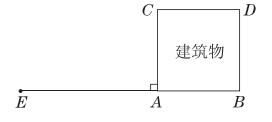

# Mathematics (Grade 6)

**ID**: 677a38a5
**难度**: medium_hard
**题型**: short_answer

## 题目
如图，有一头牛被拴在一个底面是正方形的建筑物的墙角A处，建筑物的底面边长是12m，拴牛的绳子长20m。现在牛从E点出发，拉紧绳子按顺时针方向走，最多可走多少米？

## 解答

**答案**: 43.96

1. Step1:根据圆的周长公式C = 2πr，计算以20米为半径的圆周长的$rac{1}{4}$，即20×2×3.14×$rac{1}{4}$
2. Step2:计算20 - 12 = 8米
3. Step3:根据圆的周长公式C = 2πr，计算以8米为半径的圆周长的$rac{1}{4}$，即2×3.14×8×$rac{1}{4}$
4. Step4:将上述两个结果相加，20×2×3.14×$rac{1}{4}$ + 2×3.14×8×$rac{1}{4}$ = 43.96米

## 知识点

**知识点**:
  - 圆的周长

---
