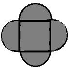

# Mathematics (Grade 6)

**ID**: 67a16386
**难度**: medium_hard
**题型**: short_answer

## 题目
校园里有一个花坛（如图），它的中心是一个边长为5的正方形，周围是四个半圆 . 这个花坛的周长是多少米？面积是多少平方米？

## 解答

**答案**: 31.4, 64.25

1. Step1:根据解析2可知，花坛周长是两个圆的周长，圆的直径等于正方形边长5，由圆的周长公式C = 2πr（r为半径），且r = 直径÷2 = 5÷2，所以花坛周长为2×3.14×(5÷2)×2 = 3.14×5×2 = 31.4米
2. Step2:根据解析2可知，花坛面积等于两个圆的面积加正方形的面积，正方形面积 = 边长×边长 = 5×5 = 25平方米，圆的半径r = 5÷2 = 2.5米，一个圆的面积为3.14×2.5²，两个圆的面积为3.14×2.5²×2，所以花坛面积为3.14×2.5²×2 + 5×5 = 3.14×6.25×2 + 25 = 3.14×12.5 + 25 = 64.25平方米

## 知识点

**知识点**:
  - --

---
