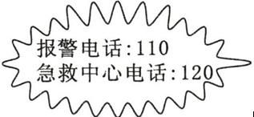

# Mathematics (Grade 6)

**ID**: 68536505
**难度**: medium_hard
**题型**: short_answer

## 题目
一个含有两级的数，其中一级上的数恰好是报警电话号码加一个“零”，另一级上的数是急救中心电话号码加一个“零”．这个数最大是多少？最小是多少？（“零”只能居号码的前面或后面）

## 解答

**答案**: 12001100, 11000120

1. Step1:明确报警电话是110，加一个零后得到1100；急救中心电话是120，加一个零后得到1200
2. Step2:比较1100和1200的大小，可得1200＞1100
3. Step3:因为要得到最大的数，所以把较大的数1200放在万级，较小的数1100放在个级，得到12001100
4. Step4:因为要得到最小的数，所以把较小的数1100放在万级，较大的数1200放在个级，又因为个级是四位数，为保证是8位数且最小，将1200写成0120放在个级，得到11000120

## 知识点

**知识点**:
  - 整数的认识；数字编码．

---
