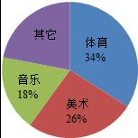

# Mathematics (Grade 6)

**ID**: 68a33251
**难度**: medium_hard
**题型**: short_answer

## 题目
统计小专家：
育才小学六年级有250人，参加课外兴趣小组分布情况如图：
（1）参加体育小组的同学比参加音乐小组的同学多多少人？
（2）参加其他兴趣小组的同学有多少人？

## 解答

**答案**: 40, 55

1. Step1:计算参加体育小组的同学比参加音乐小组的同学多总人数的百分比，即34% - 18% = 16%
2. Step2:用六年级总人数250乘上多的百分比16%，可得250×16% = 40人，这就是参加体育小组的同学比参加音乐小组的同学多的人数
3. Step3:计算参加体育、音乐、美术小组的同学占总人数的百分比之和，即34% + 18% + 26% = 78%
4. Step4:计算参加其他兴趣小组的同学占总人数的百分比，即1 - 78% = 22%
5. Step5:用六年级总人数250乘上参加其他兴趣小组同学占总人数的百分比22%，可得250×22% = 55人

## 知识点

**知识点**:
  - 统计图表的综合分析、解释和应用．

---
