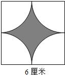

# Mathematics (Grade 6)

**ID**: 68ac387c
**难度**: medium_hard
**题型**: short_answer

## 题目
如图，求阴影部分的周长和面积各是多少？     

## 解答

**答案**: 18.84, 7.74

1. Step1:分析可知阴影部分的周长由4个直径6厘米的$\frac{1}{4}$圆的周长组成，其合起来就是一个直径为6厘米的圆的周长，根据圆的周长公式C = πd（其中C表示周长，d表示直径，π取3.14），可得周长为3.14×6 = 18.84厘米
2. Step2:分析可知阴影部分的面积等于边长6厘米正方形的面积减去4个直径6厘米的$\frac{1}{4}$圆的面积，4个$\frac{1}{4}$圆合起来是一个直径为6厘米的圆，先根据正方形面积公式S = a²（其中S表示面积，a表示边长）求出正方形面积为6×6 = 36平方厘米，再根据圆的面积公式S = πr²（其中S表示面积，r表示半径），半径r = 6÷2 = 3厘米，圆的面积为3.14×3² = 28.26平方厘米，所以阴影部分面积为36 - 28.26 = 7.74平方厘米

## 知识点

**知识点**:
  - 圆、圆环的周长;组合图形的面积．

---
