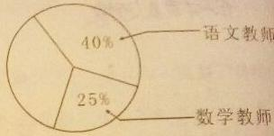

# Mathematics (Grade 6)

**ID**: 6b26e19c
**难度**: medium_hard
**题型**: short_answer

## 题目
学校语文教师占总人数的40%，数学教师占总人数的25%，其他学科教师人数占教师总人数的百分之几？
 如果学校有120名教师，语文、数学和其他学科教师各有多少人？

## 解答

**答案**: 35%, 48, 30, 42

1. Step1:把教师总人数看作单位“1”，用1减去语文教师占总人数的40%，再减去数学教师占总人数的25%，即1 - 40% - 25% = 35%，得到其他学科教师人数占教师总人数的百分比
2. Step2:已知学校有120名教师，用120乘以语文教师占总人数的40%，即120×40% = 48人，得到语文教师的人数
3. Step3:用120乘以数学教师占总人数的25%，即120×25% = 30人，得到数学教师的人数
4. Step4:用120乘以其他学科教师占总人数的35%，即120×35% = 42人，得到其他学科教师的人数

## 知识点

**知识点**:
  - --

---
