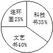

# Mathematics (Grade 6)

**ID**: 6c5e0ffc
**难度**: medium_hard
**题型**: short_answer

## 题目
如图是希望小学图书室图书统计图，其中连环画有200本．
（1）请你算出这个学校图书室一共有多少本图书？
（2）希望小学科技书有多少本？

## 解答

**答案**: 800, 280

1. Step1:已知连环画有200本，占比25%，根据百分数除法的意义，用连环画的本数除以其占比，即200÷25%，可算出学校图书室图书的总本数为800本
2. Step2:已算出学校图书室图书总本数为800本，科技书占比35%，根据百分数乘法的意义，用总本数乘科技书的占比，即800×35%，可算出希望小学科技书有280本

## 知识点

**知识点**:
  - 扇形统计图;从统计图表中获取信息

---
