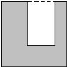

# Mathematics (Grade 6)

**ID**: 6c97aed5
**难度**: medium_hard
**题型**: short_answer

## 题目
在一张边长10厘米的正方形纸中，剪去一个长6厘米、宽4厘米的长方形．剩下部分的面积是多少？剩下部分的周长呢？

## 解答

**答案**: 76（平方厘米）, 52（厘米）

1. Step1:根据正方形面积公式S=a²，其中a = 10厘米，可得正方形纸的面积为10×10 = 100平方厘米
2. Step2:根据长方形面积公式S = ab，其中a = 6厘米，b = 4厘米，可得剪去的长方形的面积为6×4 = 24平方厘米
3. Step3:用正方形纸的面积减去长方形的面积，即100 - 24 = 76平方厘米，得到剩下部分的面积
4. Step4:根据正方形周长公式C = 4a，其中a = 10厘米，可得正方形纸的周长为10×4 = 40厘米
5. Step5:由图可知剩下部分的周长比原来正方形的周长增加了6×2 = 12厘米
6. Step6:将正方形纸的周长加上增加的长度，即40 + 12 = 52厘米，得到剩下部分的周长

## 知识点

**知识点**:
  - 长方形、正方形的面积;长方形的周长

---
