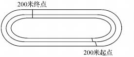

# Mathematics (Grade 6)

**ID**: 6dd2f99e
**难度**: medium_hard
**题型**: short_answer

## 题目
某校400米跑道的内两圈如图所示，弯道为半圆形，跑道宽1.2米。两名运动员进行200米比赛，外跑道的运动员的起跑点应前移多少米？

## 解答

**答案**: 7.536

1. Step1:明确200米比赛中外跑道运动员起跑点前移距离是外圆周长与内圆周长的差
2. Step2:根据圆的周长公式C = 2πr（C表示周长，r表示半径，π取3.14），可知外圆周长 - 内圆周长 = 2×圆周率×（外圆半径 - 内圆半径）
3. Step3:已知跑道宽1.2米，即外圆半径 - 内圆半径 = 1.2米
4. Step4:将圆周率取3.14，外圆半径 - 内圆半径 = 1.2米代入2×圆周率×（外圆半径 - 内圆半径），得到2×3.14×1.2
5. Step5:计算2×3.14×1.2 = 6.28×1.2 = 7.536米

## 知识点

**知识点**:
  - 圆的周长

---
