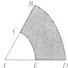

# Mathematics (Grade 6)

**ID**: 6f56501e
**难度**: medium_hard
**题型**: short_answer

## 题目
如图所示，半径AB为18厘米，C是AB中点，圆心角BAD是60°，求阴影部分的周长．

## 解答

**答案**: 46.26

1. Step1:计算半径为18厘米的圆的周长，根据圆的周长公式C = 2πr（其中r = 18厘米，π取3.14），可得2×3.14×18 = 113.04厘米
2. Step2:计算半径为9厘米（因为C是AB中点，AB = 18厘米，所以AC = 9厘米）的圆的周长，根据圆的周长公式C = 2πr（其中r = 9厘米，π取3.14），可得2×3.14×9 = 56.52厘米
3. Step3:计算圆心角是60度的半径18厘米的扇形的弧长，根据弧长公式l = $rac{n}{360}$×2πr（n = 60，r = 18厘米，π取3.14），可得$rac{60}{360}$×113.04 = 18.84厘米
4. Step4:计算圆心角是60度的半径9厘米的扇形的弧长，根据弧长公式l = $rac{n}{360}$×2πr（n = 60，r = 9厘米，π取3.14），可得$rac{60}{360}$×56.52 = 9.42厘米
5. Step5:将两个扇形的弧长相加，18.84 + 9.42 = 28.26厘米
6. Step6:再加上18厘米，28.26 + 18 = 46.26厘米

## 知识点

**知识点**:
  - 圆、圆环的周长．

---
