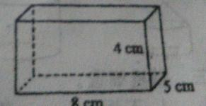

# Mathematics (Grade 6)

**ID**: 70472980
**难度**: medium_hard
**题型**: short_answer

## 题目
一个长方体木块的长、宽、高分别是8cm、5cm、4cm．如果把它锯成一个最大的正方体，体积要比原来减少百分之几？

## 解答

**答案**: 60%

1. Step1:计算长方体体积，根据长方体体积公式V = a×b×c（a、b、c分别为长方体的长、宽、高），可得长方体体积为8×5×4 = 160立方厘米
2. Step2:确定锯成的最大正方体的棱长，因为正方体的棱长都相等，所以以长方体最短的边4cm为正方体的棱长，根据正方体体积公式V = a³（a为正方体棱长），可得正方体体积为4×4×4 = 64立方厘米
3. Step3:计算体积减少的量，用长方体体积减去正方体体积，即160 - 64 = 96立方厘米
4. Step4:计算体积比原来减少的百分比，用减少的体积除以长方体体积，即96÷160 = 0.6，化为百分数为60%

## 知识点

**知识点**:
  - --

---
