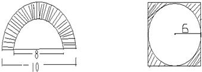

# Mathematics (Grade 6)

**ID**: 710b2051
**难度**: medium_hard
**题型**: short_answer

## 题目
计算阴影部分的面积．( 单位：厘米)

## 解答

**答案**: 14.13, 30.96

1. Step1:计算第一个图形中大半圆的半径，10÷2=5（厘米）
2. Step2:计算第一个图形中小半圆的半径，8÷2=4（厘米）
3. Step3:根据圆环面积公式计算第一个图形中阴影部分面积，3.14×(5**2 - 4**2)÷2 = 3.14×(25 - 16)÷2 = 3.14×9÷2 = 14.13（平方厘米）
4. Step4:计算第二个图形中正方形的边长，6×2 = 12（厘米）
5. Step5:计算第二个图形中正方形的面积，12×12 = 144（平方厘米）
6. Step6:计算第二个图形中圆的面积，3.14×6**2 = 113.04（平方厘米）
7. Step7:计算第二个图形中阴影部分面积，144 - 113.04 = 30.96（平方厘米）

## 知识点

**知识点**:
  - 圆、圆环的面积．

---
