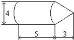

# Mathematics (Grade 6)

**ID**: 71335bfc
**难度**: medium_hard
**题型**: short_answer

## 题目
计算如图形体的体积．(单位；分米)

## 解答

**答案**: 75.36

1. Step1:计算圆柱底面半径，4÷2 = 2(分米)
2. Step2:根据圆柱体积公式v = sh（s为底面积，h为高），计算圆柱体积，3.14×2²×5 = 3.14×4×5 = 62.8(立方分米)
3. Step3:根据圆锥体积公式v = 1/3sh，计算圆锥体积，1/3×3.14×2²×3 = 1/3×3.14×4×3 = 12.56(立方分米)
4. Step4:将圆柱体积和圆锥体积相加得到图形体积，62.8 + 12.56 = 75.36(立方分米)

## 知识点

**知识点**:
  - 组合图形的体积．

---
