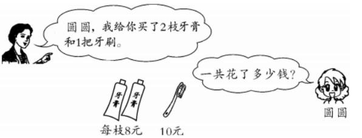

# Mathematics (Grade 6)

**ID**: 723289c1
**难度**: medium_hard
**题型**: short_answer

## 题目

圆圆，我给你买了2枝牙膏和1把牙刷。每支牙膏8元，每支牙刷10元，一共花了多少钱？

## 解答

**答案**: 26

1. Step1:根据题目可知牙膏单价为8元，购买数量为2枝，由总价=单价×数量，可得买牙膏花的钱数为8×2=16元
2. Step2:根据题目可知牙刷单价为10元，购买数量为1把，由总价=单价×数量，可得买牙刷花的钱数为10×1=10元
3. Step3:将买牙膏的钱数16元和买牙刷的钱数10元相加，即16 + 10 = 26元，得出一共花的钱数

## 知识点

**知识点**:
  - 整数的加法和减法;表内乘法;整数复合应用题

---
