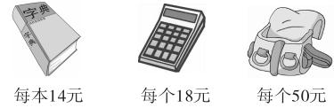

# Mathematics (Grade 6)

**ID**: 74fcdc32
**难度**: medium_hard
**题型**: short_answer

## 题目
购买学习用具。

（1）买3本字典需要多少元钱？
（2）明明带80元钱，买4个计算器够不够？
（3）请你再提出一个数学问题，并解答。

## 解答

**答案**: 42, 72, 100

1. Step1:根据总钱数=单价×数量，字典单价为14元，数量为3本，计算买3本字典的钱数，14×3=42元，得到第一个答案42
2. Step2:先计算买4个计算器的钱数，计算器单价为18元，18×4=72元，再与80元比较大小，80＞72，得到第二个答案72
3. Step3:提出问题买2个书包多少钱，书包单价为50元，计算50×2=100元，得到第三个答案100

## 知识点

**知识点**:
  - 一位数乘两、三位数

---
