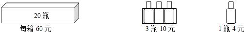

# Mathematics (Grade 6)

**ID**: 77282652
**难度**: medium_hard
**题型**: short_answer

## 题目
下面是同一种盒装饮料的价钱．妈妈要买37瓶饮料，最省钱的买法一共要多少元？

## 解答

**答案**: 118

1. Step1:计算每瓶的单价，整箱买时每瓶单价为60÷20 = 3元，3瓶10元时每瓶单价为10÷3 = $rac{10}{3}$元，单买1瓶时单价为4元，比较可得3＜$rac{10}{3}$＜4，所以要尽量多买成箱的，其次买10元3瓶的，最后买单瓶的
2. Step2:确定购买方案，因为要购买37瓶，先买1箱20瓶，此时还需37 - 20 = 17瓶
3. Step3:接着买10元3瓶的，17÷3 = 5（组）……2（瓶），即可以买5组10元3瓶的，此时还剩2瓶
4. Step4:剩下2瓶按单瓶4元购买
5. Step5:计算总花费，1箱的价格为60元，5组10元3瓶的花费为10×5 = 50元，2瓶单买花费4×2 = 8元，总花费为60 + 50 + 8 = 118元

## 知识点

**知识点**:
  - 图文应用题

---
