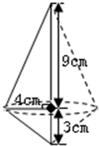

# Mathematics (Grade 6)

**ID**: 77a25dd7
**难度**: medium_hard
**题型**: short_answer

## 题目
如图的三角形以AB为轴旋转一周后得到办得到图形(如下图)，求旋转后得到的图形的体积．

## 解答

**答案**: 200.96

1. Step1:根据解析2可知，旋转后得到的是上下两个圆锥体，其底面半径r = 4厘米，高的和h = 9 + 3 = 12厘米
2. Step2:圆锥体积公式为V = $\frac{1}{3}×\pi×r^{2}×h$，这里$\pi$取3.14，r = 4，h = 12，代入公式可得V = $\frac{1}{3}×3.14×4^{2}×12$
3. Step3:先计算4² = 16，式子变为$\frac{1}{3}×3.14×16×12$
4. Step4:计算$\frac{1}{3}×3.14×16×12$的结果，$\frac{1}{3}×12 = 4$，4×3.14×16 = 200.96立方厘米，此即为旋转后图形的体积

## 知识点

**知识点**:
  - 将简单图形平移或旋转一定的度数;圆锥的体积．

---
