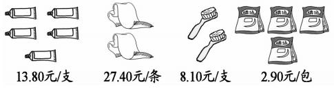

# Mathematics (Grade 6)

**ID**: 783679fe
**难度**: medium_hard
**题型**: short_answer

## 题目
妈妈准备购买下面这些商品，带150元够吗？ 

## 解答

**答案**: 152元, 带150元不够

1. Step1:将牙膏单价13.80元估算为14元，毛巾单价27.40元估算为27元，牙刷单价8.10元估算为8元，其他商品单价2.90元估算为3元
2. Step2:计算牙膏的估算总价为14×5 = 70元
3. Step3:计算毛巾的估算总价为27×2 = 54元
4. Step4:计算牙刷的估算总价为8×2 = 16元
5. Step5:计算其他商品的估算总价为3×4 = 12元
6. Step6:计算所有商品的估算总价为70 + 54 + 16 + 12 = 152元
7. Step7:比较估算总价152元与150元的大小，得出152元＞150元，判断带150元不够

## 知识点

**知识点**:
  - 估算

---
