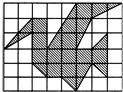

# Mathematics (Grade 6)

**ID**: 78c91cbb
**难度**: medium_hard
**题型**: short_answer

## 题目
如图，正方形网格的总面积等于96平方厘米，求阴影图形的面积．

## 解答

**答案**: 38(平方厘米)

1. Step1:计算每个小正方形的面积，由正方形网格总面积为96平方厘米，网格是6行8列，可得96÷(6×8)=2平方厘米
2. Step2:确定阴影部分面积与长方形面积的关系，即阴影部分的面积比长是5个格，宽是4个格的长方形的面积少一个格
3. Step3:计算长是5个格，宽是4个格的长方形包含的小正方形个数为4×5个，再减去少的1个格，得到阴影部分包含的小正方形个数为4×5 - 1 = 19个
4. Step4:计算阴影部分面积，因为每个小正方形面积是2平方厘米，所以阴影部分面积为19×2 = 38平方厘米

## 知识点

**知识点**:
  - 组合图形的面积．

---
