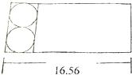

# Mathematics (Grade 6)

**ID**: 7a2bfbe4
**难度**: medium_hard
**题型**: short_answer

## 题目
如图，用下图的材料拼成一个圆柱，求圆柱的表面积．（单位：cm）

## 解答

**答案**: 125.6

1. Step1:设圆的直径为d厘米，根据圆的直径+底面周长=长方形的长，可列方程d+πd=16.56
2. Step2:解方程d+πd=16.56，因为π取3.14，所以4.14d=16.56，得出d=4
3. Step3:计算圆柱的底面积，根据圆的面积公式S = 3.14×（r）²，r=d÷2=4÷2=2厘米，所以底面积为3.14×（4÷2）²，两个底面积为3.14×（4÷2）²×2
4. Step4:计算圆柱的侧面积，长方形的长为16.56厘米，圆的直径d = 4厘米，所以长方形的长减去圆的直径就是圆柱底面圆的周长，即16.56 - 4，圆柱的高等于圆的直径的2倍，即4×2，侧面积为（16.56 - 4）×（4×2）
5. Step5:计算圆柱的表面积，将两个底面积与侧面积相加，即3.14×（4÷2）²×2+（16.56 - 4）×（4×2）=3.14×4×2+12.56×8=12.56×2+100.48=25.12+100.48=125.6平方厘米

## 知识点

**知识点**:
  - 圆柱的侧面积、表面积和体积

---
