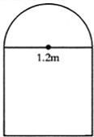

# Mathematics (Grade 6)

**ID**: 7a563297
**难度**: medium_hard
**题型**: short_answer

## 题目
希望小学的阅览室有4个同样大小的窗户，上面是半圆，下面是正方形．（如图所示）
（1）每个窗户的面积约是多少平方米？（得数保留整数）．
（2）如果制作这样的窗户每平方米需要工料费150元，那么4个窗户共要工料费多少元？

## 解答

**答案**: 2, 1200

1. Step1:根据解析2，明确窗户由半圆和正方形组成，半圆直径和正方形边长均为1.2米
2. Step2:计算半圆面积，根据圆面积公式S = πr²，半圆面积为3.14×（1.2÷2）²÷2 = 3.14×0.36÷2 = 0.5652平方米
3. Step3:计算正方形面积，根据正方形面积公式S = a²，正方形面积为1.2×1.2 = 1.44平方米
4. Step4:计算每个窗户面积，半圆面积与正方形面积相加，0.5652 + 1.44 ≈ 2平方米，得到第一问答案
5. Step5:根据解析2，计算每个窗户工料费为2×150 = 300元
6. Step6:计算4个窗户工料费为300×4 = 1200元，得到第二问答案

## 知识点

**知识点**:
  - 组合图形的面积．

---
