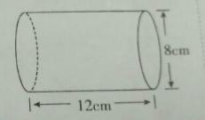

# Mathematics (Grade 6)

**ID**: 7a798686
**难度**: medium_hard
**题型**: short_answer

## 题目
计算下面圆柱的表面积和体积。

 12cm   8cm

## 解答

**答案**: 138.16, 602.88

1. Step1:先计算圆柱底面半径，由直径8cm可得半径r = 8÷2 = 4cm
2. Step2:计算圆柱的侧面积，根据侧面积公式S侧 = πdh，d = 8cm，h = 12cm，所以S侧 = 3.14×8×12 = 301.44平方厘米
3. Step3:计算圆柱的底面积，根据圆的面积公式S底 = πr²，r = 4cm，所以S底 = 3.14×4² = 50.24平方厘米
4. Step4:计算圆柱的表面积，由圆柱表面积公式S表 = S侧 + 2×S底，可得S表 = 301.44 + 2×50.24 = 301.44 + 100.48 = 401.92平方厘米
5. Step5:计算圆柱的体积，根据圆柱体积公式V = πr²h，r = 4cm，h = 12cm，所以V = 3.14×4²×12 = 3.14×16×12 = 602.88立方厘米

## 知识点

**知识点**:
  - --

---
