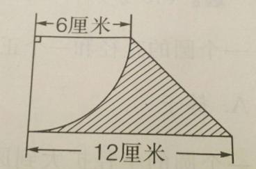

# Mathematics (Grade 6)

**ID**: 7a947fa1
**难度**: medium_hard
**题型**: short_answer

## 题目
求阴影部分的面积．

 6厘米  12厘米

## 解答

**答案**: 41.44

1. Step1:明确梯形的上底为6厘米
2. Step2:明确梯形的下底为12厘米
3. Step3:明确梯形的高为6厘米
4. Step4:根据梯形面积公式(上底+下底)×高÷2，计算梯形面积为(6 + 12)×6÷2 = 54平方厘米
5. Step5:明确圆的半径为6厘米
6. Step6:根据圆的面积公式S = πr²，计算圆的面积为3.14×6² = 113.04平方厘米
7. Step7:计算圆面积的四分之一为113.04÷4 = 28.26平方厘米
8. Step8:用梯形面积减去圆面积的四分之一，即54 - 28.26 = 41.44平方厘米

## 知识点

**知识点**:
  - --

---
