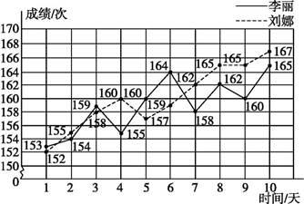

# Mathematics (Grade 6)

**ID**: 7c28b0fb
**难度**: medium_hard
**题型**: short_answer

## 题目
下图是李丽和刘娜近10天跳绳成绩次数情况统计图．

(1)李丽和刘娜第几天跳的成绩最好?
(2)比一比,谁的跳绳成绩更好一点?你是如何比较的?如果班级里需要选一名同学去参加学校的跳绳比赛,你觉得谁去更合适?

## 解答

**答案**: 第10天, 刘娜

1. Step1:观察统计图，找到李丽和刘娜成绩各自的最高点对应的天数，发现两人都是在第10天成绩达到最高，所以第（1）问答案是第10天
2. Step2:观察两人成绩的整体变化趋势，前期李丽成绩比刘娜好，但从第5天之后，刘娜成绩持续提高，而李丽成绩出现波动不稳定，综合比较得出刘娜的跳绳成绩更好一点，所以第（2）问第一个答案是刘娜
3. Step3:因为刘娜成绩后期更好且更稳定，所以如果班级选一名同学参加学校跳绳比赛，刘娜去更合适，完成第（2）问

## 知识点

**知识点**:
  - 小学数学;统计和概率;统计;统计图表的综合应用

---
