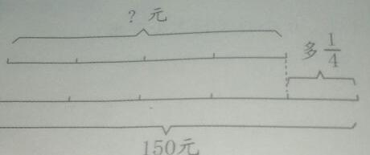

# Mathematics (Grade 6)

**ID**: 7d7f5885
**难度**: medium_hard
**题型**: short_answer

## 题目
比原来多
 $\frac{1}{4}$
  是150元，问原来是多少元？

 ？元  多
 $\frac{1}{4}$
  150元

## 解答

**答案**: 125

1. Step1:把原来的钱数看成单位'1'，现在的钱数比原来多$\frac{1}{4}$，那么现在的钱数是原来的$1 + \frac{1}{4}$
2. Step2:已知现在的钱数是150元，且现在的钱数是原来的$1 + \frac{1}{4}$，求原来的钱数，根据已知一个数的几分之几是多少，求这个数用除法，所以用150除以$1 + \frac{1}{4}$
3. Step3:计算$150\div(1 + \frac{1}{4}) = 150\div\frac{5}{4} = 150	imes\frac{4}{5} = 120$，得到原来的钱数为120元

## 知识点

**知识点**:
  - --

---
