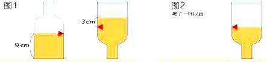

# Mathematics (Grade 6)

**ID**: 7e7b4570
**难度**: medium_hard
**题型**: short_answer

## 题目
一个瓶子里装有果汁．果汁的高度如图左侧红色箭头所示，为9cm．把瓶子倒过来时，果汁的高度比红色箭头所示的位置高3cm，如图2，倒出果汁后，在把瓶子倒过来时，果汁的高度就根红色箭头持平了．请问：瓶子装满果汁时是几杯？

## 解答

**答案**: 5

1. Step1:设瓶子的底面积为S，根据果汁高度为9cm，得出瓶子里原有饮料的体积为9S
2. Step2:由倒过来时果汁的高度比红色箭头所示的位置高3cm，可知倒出的果汁体积为3S
3. Step3:计算剩余果汁体积为9S - 3S = 6S
4. Step4:计算这瓶果汁的总体积为9S + 6S = 15S
5. Step5:用总体积15S除以倒出的果汁体积3S，即15S÷3S = 5，得出瓶子装满果汁时是5杯

## 知识点

**知识点**:
  - 圆柱的侧面积、表面积和体积

---
