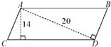

# Mathematics (Grade 6)

**ID**: 8007b4f6
**难度**: medium_hard
**题型**: short_answer

## 题目
以BD为边时，高20cm，以CD为边时，高14cm，▱ABCD周长为102厘米，求面积？

## 解答

**答案**: 30, 420

1. Step1:根据平行四边形面积公式，面积 = 底×高，可知面积一定时，底和高成反比，所以 CD 与 BD 的比等于 BD 边上高与 CD 边上高的比，即 CD:BD = 20:14 = 10:7
2. Step2:因为平行四边形对边相等，所以周长 = 2×(CD + BD)，那么 CD + BD = 102÷2 = 51 厘米
3. Step3:已知 CD:BD = 10:7，CD + BD = 51 厘米，根据按比例分配，可得 CD 的长度为 51÷(10 + 7)×10 = 30 厘米
4. Step4:已知以 CD 为边时高为 14 厘米，根据平行四边形面积公式，面积 = CD×14 = 30×14 = 420 平方厘米
5. Step5:整理答案为 ['30', '420']

## 知识点

**知识点**:
  - 组合图形的面积

---
