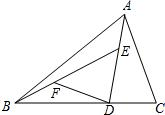

# Mathematics (Grade 6)

**ID**: 814cb404
**难度**: medium_hard
**题型**: short_answer

## 题目
如图，在三角形ABC中，D、E、F分别是BC、AD、BE的三等分点，已知三角形ABC的面积是27，则三角形EFD的面积是多少？

## 解答

**答案**: 8

1. Step1:因为D是BC的三等分点，所以BD=$rac{2}{3}$BC，根据等高三角形面积比等于底边比，可得△ABD的面积是△ABC面积的$rac{2}{3}$，即△ABD的面积为$rac{2}{3}$×27 = 18平方厘米
2. Step2:因为E是AD的三等分点，所以ED=$rac{2}{3}$AD，同理可得△BED的面积是△ABD面积的$rac{2}{3}$，即△BED的面积为$rac{2}{3}$×18 = 12平方厘米
3. Step3:因为F是BE的三等分点，所以EF=$rac{2}{3}$BE，同理可得△EFD的面积是△BED面积的$rac{2}{3}$，即△EFD的面积为$rac{2}{3}$×12 = 8平方厘米

## 知识点

**知识点**:
  - 三角形面积与底的正比关系．

---
