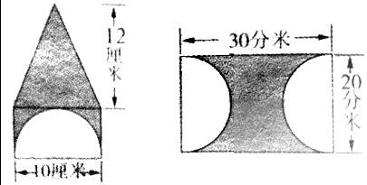

# Mathematics (Grade 6)

**ID**: 81565b59
**难度**: medium_hard
**题型**: short_answer

## 题目
求阴影部分的面积．

## 解答

**答案**: 70.75, 286

1. Step1:对于第一个图形，先计算三角形面积，三角形底为10厘米，高为12厘米，根据三角形面积公式S = 底×高÷2，可得10×12÷2 = 60平方厘米
2. Step2:计算长方形面积，长方形长为10厘米，宽为10÷2 = 5厘米，根据长方形面积公式S = 长×宽，可得10×（10÷2） = 50平方厘米
3. Step3:计算空白半圆面积，半圆半径为10÷2 = 5厘米，根据圆的面积公式S = πr²，可得半圆面积为3.14×（10÷2）²÷2 = 39.25平方厘米
4. Step4:根据阴影部分的面积=三角形的面积+长方形面积-空白半圆的面积，可得60 + 50 - 39.25 = 70.75平方厘米
5. Step5:对于第二个图形，先计算长方形面积，长方形长为30分米，宽为20分米，根据长方形面积公式S = 长×宽，可得30×20 = 600平方分米
6. Step6:计算圆的面积，圆半径为20÷2 = 10分米，根据圆的面积公式S = πr²，可得3.14×（20÷2）² = 314平方分米
7. Step7:根据阴影部分的面积=长方形面积-圆的面积，可得600 - 314 = 286平方分米

## 知识点

**知识点**:
  - 组合图形的面积

---
