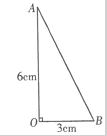

# Mathematics (Grade 6)

**ID**: 816cc57a
**难度**: medium_hard
**题型**: short_answer

## 题目
如图，如果把三角形AOB以AO为轴旋转一圈，形成的圆锥的体积是多少立方厘米？

## 解答

**答案**: 56.52

1. Step1:明确圆锥体积公式为v = $rac{1}{3}$πr²h
2. Step2:根据图形得出圆锥底面半径r = 3cm
3. Step3:根据图形得出圆锥的高h = 6cm
4. Step4:将r = 3cm，h = 6cm代入圆锥体积公式，得到v = $rac{1}{3}$×3.14×3²×6
5. Step5:计算$rac{1}{3}$×3.14×3²×6 = $rac{1}{3}$×3.14×9×6
6. Step6:计算$rac{1}{3}$×3.14×9×6 = 3.14×18
7. Step7:计算3.14×18 = 56.52，得到圆锥体积为56.52立方厘米

## 知识点

**知识点**:
  - 圆锥的体积;将简单图形平移或旋转一定的度数

---
