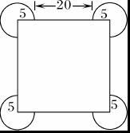

# Mathematics (Grade 6)

**ID**: 819bf8fc
**难度**: medium_hard
**题型**: short_answer

## 题目
如图是一个花台的平面图，5为圆的半径（单位：m）．求这个花台的周长是多少厘米？

## 解答

**答案**: 214.2

1. Step1:分析图形可知，花台的周长由一个正方形的周长和部分圆的周长组成。正方形的边长为20 + 5 + 5 = 30（m），根据正方形周长公式C = 4a（a为边长），可得正方形周长为30×4 = 120（m）。
2. Step2:每个圆的半径为5m，根据圆的周长公式C = 2πr（r为半径），一个圆的周长为2×3.14×5 = 31.4（m）。
3. Step3:图中有4个四分之一圆，合起来相当于1个完整的圆，还有3个完整的圆，总共相当于4个完整的圆的周长，即2×3.14×5×4 = 125.6（m）。
4. Step4:用正方形的周长加上4个圆的周长再减去1个圆的周长，即120 + 2×3.14×5×4 - 2×3.14×5 = 120 + 125.6 - 31.4 = 214.2（m）。
5. Step5:因为问题问的是多少厘米，进行单位换算，1m = 100cm，214.2m = 214.2×100 = 21420厘米，最终答案为21420厘米

## 知识点

**知识点**:
  - 有关圆的应用题

---
