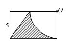

# Mathematics (Grade 6)

**ID**: 83456676
**难度**: medium_hard
**题型**: short_answer

## 题目
下图中长方形的面积是45平方米，则阴影部分的面积是多少平方米？

## 解答

**答案**: 15.375

1. Step1:根据长方形面积公式S=长×宽，已知长方形面积是45平方米，宽是5米，可得长方形的长为45÷5 = 9米
2. Step2:计算三角形的底，长方形长为9米，宽为5米，三角形底为9 - 5 = 4米
3. Step3:根据三角形面积公式S=底×高÷2，三角形底为4米，高为5米，可得三角形面积为4×5÷2 = 10平方米
4. Step4:根据圆的面积公式S=πr²，这里半径r = 5米，可得$\frac{1}{4}$圆的面积为3.14×5²×$\frac{1}{4}$= 19.625平方米
5. Step5:根据阴影部分的面积=长方形的面积-三角形的面积-$\frac{1}{4}$圆的面积，长方形面积是45平方米，三角形面积是10平方米，$\frac{1}{4}$圆的面积是19.625平方米，可得阴影部分面积为45 - 10 - 19.625 = 15.375平方米

## 知识点

**知识点**:
  - 组合图形的面积

---
