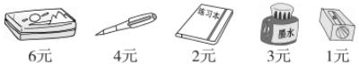

# Mathematics (Grade 6)

**ID**: 83a94f44
**难度**: medium_hard
**题型**: short_answer

## 题目
妈妈给明明20元钱，让他买一些文具。请你帮他制订一个方案，他可以买下面哪些文具？     

## 解答

**答案**: 1个铅笔盒, 2本练习本, 1支圆珠笔, 2瓶墨水

1. Step1:明确目标是用20元制订购买文具的方案，条件是购买文具所需钱数不超过20元
2. Step2:考虑文具价格，铅笔盒6元，练习本2元，圆珠笔4元，墨水3元，削笔器1元
3. Step3:尝试组合文具，计算1个铅笔盒、2本练习本、1支圆珠笔和2瓶墨水的价格，即6 + 2×2 + 4 + 3×2 = 20元，刚好符合20元的预算
4. Step4:确定购买方案为1个铅笔盒，2本练习本，1支圆珠笔和2瓶墨水

## 知识点

**知识点**:
  - 整数的乘（除）加、减的两步混合运算

---
