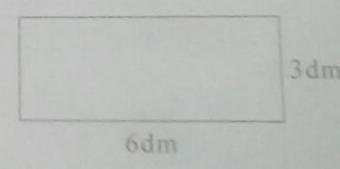

# Mathematics (Grade 6)

**ID**: 84ac535f
**难度**: medium_hard
**题型**: short_answer

## 题目
李师傅要在一张长6dm，宽3dm的白铁皮上截下最大的圆片作盆底，能截下几个圆片呢？剩下铁皮的面积是多少？

 3dm     6dm

## 解答

**答案**: 2, 3.87dm^2

1. Step1:根据白铁皮的宽是3dm，确定能截下的最大圆片的直径为3dm
2. Step2:用白铁皮的长6dm除以圆片直径3dm，即6÷3=2，得出能截下圆片的数量为2个
3. Step3:计算圆片的半径，由直径3dm可得半径为3÷2=1.5dm
4. Step4:计算长方形白铁皮的面积，根据长方形面积公式，面积为6×3=18dm²
5. Step5:计算一个圆片的面积，根据圆的面积公式，一个圆片面积为3.14×1.5²
6. Step6:计算两个圆片的总面积，为3.14×1.5²×2=14.13dm²
7. Step7:用长方形白铁皮的面积减去两个圆片的总面积，即18 - 14.13 = 3.87dm²，得到剩下铁皮的面积

## 知识点

**知识点**:
  - --

---
