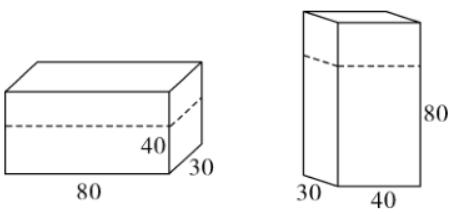

# Mathematics (Grade 6)

**ID**: 84cb609e
**难度**: medium_hard
**题型**: short_answer

## 题目
一个密封的长方体水箱，从里面量长80cm，宽30cm，高40cm。当水箱如左下图所示放置时，水深为25cm；当水箱如右下图所示放置时，水深又是多少厘米？
、

## 解答

**答案**: 50

1. Step1:明确本题是长方体体积计算类型题目，水的体积不变
2. Step2:根据长方体体积公式长×宽×高，计算水的体积为80×30×25
3. Step3:计算右下图放置时水箱的底面积为40×30
4. Step4:根据水面的高=水的体积÷底面积，计算右下图放置时的水深为80×30×25÷(40×30)
5. Step5:计算80×30×25÷(40×30)的结果为50

## 知识点

**知识点**:
  - 长方体和正方体的体积

---
