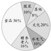

# Mathematics (Grade 6)

**ID**: 85d65389
**难度**: medium_hard
**题型**: short_answer

## 题目
小丽家12月家庭支出情况如图：
小丽家本月支出共1200元，请选择两项计算出支出钱数．

## 解答

**答案**: 120, 240

1. Step1:明确家庭本月支出总钱数为1200元
2. Step2:根据扇形统计图，服装支出占总支出的10%，计算服装支出为1200×10% = 120元
3. Step3:根据扇形统计图，文化支出占总支出的20%，计算文化支出为1200×20% = 240元

## 知识点

**知识点**:
  - 扇形统计图

---
