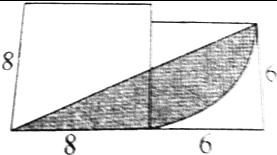

# Mathematics (Grade 6)

**ID**: 8632e6c9
**难度**: medium_hard
**题型**: short_answer

## 题目
求下列阴影部分面积．（单位：cm）

## 解答

**答案**: 34.26

1. Step1:先计算大三角形的底，8 + 6 = 14(cm)
2. Step2:计算大三角形的面积，14×6÷2 = 42(cm²)
3. Step3:计算正方形的面积，6×6 = 36(cm²)
4. Step4:计算四分之一圆的面积，3.14×6²÷4 = 28.26(cm²)
5. Step5:计算右下角空白部分的面积，36 - 28.26 = 7.74(cm²)
6. Step6:用大三角形面积减去右下角空白部分面积得到阴影部分面积，42 - 7.74 = 34.26(cm²)

## 知识点

**知识点**:
  - 组合图形的面积

---
