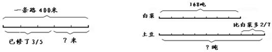

# Mathematics (Grade 6)

**ID**: 8662fa22
**难度**: medium_hard
**题型**: short_answer

## 题目
看图列式计算．

## 解答

**答案**: 160（米）, 216（吨）

1. Step1:分析第一个图，把路的总长400米看作单位“1”，已修了$rac{3}{5}$，则没修的占比为1 - $rac{3}{5}$
2. Step2:根据上述占比，计算没修的长度，用路的总长400米乘以没修的占比，即400×(1 - $rac{3}{5}$) = 400×$rac{2}{5}$ = 160米
3. Step3:分析第二个图，把白菜的吨数168吨看作单位“1”，土豆比白菜多$rac{2}{7}$，则土豆的吨数占白菜吨数的1 + $rac{2}{7}$
4. Step4:根据上述占比，计算土豆的吨数，用白菜的吨数168吨乘以土豆占白菜的占比，即168×(1 + $rac{2}{7}$) = 168×$rac{9}{7}$ = 216吨

## 知识点

**知识点**:
  - 分数乘法应用题

---
