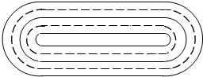

# Mathematics (Grade 6)

**ID**: 8bdb6809
**难度**: medium_hard
**题型**: short_answer

## 题目
某运动场的200米跑道如图(1)所示，弯道为半圆形，跑道宽为1.22米，两名运动员沿各自跑道赛跑一周，为使二人距离相等，应让外跑道的运动员前移多少米？
(得数保留两位小数)

## 解答

**答案**: 7.66

1. Step1:明确第一、第二两条跑道直线部分长度一致，差异在弯道部分。设第一跑道半径为x米，则第二跑道半径为(x+1.22)米
2. Step2:由于两边弯道合起来是整圆，得出跑道一圆周部分长度为2πx，跑道二圆周部分长度为2π(x+1.22)
3. Step3:计算外跑道（跑道二）比内跑道（跑道一）多出的长度，即2π(x+1.22)-2πx，展开式子得到2πx+2π×1.22-2πx
4. Step4:化简式子2πx+2π×1.22-2πx，得到2π×1.22
5. Step5:将π取值3.14代入2π×1.22，计算2×3.14×1.22
6. Step6:将2×3.14×1.22的结果保留两位小数，得到约7.66米

## 知识点

**知识点**:
  - 有关圆的应用题．

---
