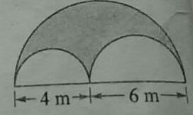

# Mathematics (Grade 6)

**ID**: 8ddc6bb4
**难度**: medium_hard
**题型**: short_answer

## 题目
求出图形中阴影部分的面积

 4m  6m

## 解答

**答案**: 18.84

1. Step1:计算大半圆的半径，由(4 + 6)÷2 = 5m
2. Step2:计算大半圆的面积，为5×5×3.14÷2
3. Step3:计算第一个小半圆的半径，4÷2 = 2m
4. Step4:计算第一个小半圆的面积，2×2×3.14÷2
5. Step5:计算第二个小半圆的半径，6÷2 = 3m
6. Step6:计算第二个小半圆的面积，3×3×3.14÷2
7. Step7:用大半圆面积减去两个小半圆面积，即(25 - 4 - 9)×3.14÷2
8. Step8:计算得出结果为18.84平方米

## 知识点

**知识点**:
  - --

---
