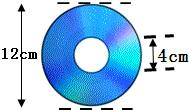

# Mathematics (Grade 6)

**ID**: 8e57d6dc
**难度**: medium_hard
**题型**: short_answer

## 题目
右图是一张CD光盘的平面图，请根据所标数据计算CD光盘的面积？     

## 解答

**答案**: 100.48

1. Step1:明确光盘是圆环形状，根据圆环面积公式圆环的面积 = π×$R^{2}−r^{2}$，需要先找出外圆半径R和内圆半径r
2. Step2:由图可知外圆直径为12cm，根据半径等于直径的一半，可得外圆半径R = 12÷2 = 6cm
3. Step3:由图可知内圆直径为4cm，根据半径等于直径的一半，可得内圆半径r = 4÷2 = 2cm
4. Step4:将R = 6cm，r = 2cm代入圆环面积公式，得到3.14×$6^{2}−2^{2}$
5. Step5:先计算括号内的值，$6^{2}=36$，$2^{2}=4$，则$6^{2}−2^{2}=36 - 4 = 32$
6. Step6:再计算3.14×32 = 100.48平方厘米

## 知识点

**知识点**:
  - 圆、圆环的面积．

---
