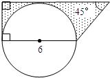

# Mathematics (Grade 6)

**ID**: 8ecb5145
**难度**: medium_hard
**题型**: short_answer

## 题目
求阴影部分的面积（单位：厘米）

## 解答

**答案**: 8.37

1. Step1:明确阴影部分面积的计算方法为梯形面积减去半圆面积
2. Step2:计算圆的半径，由圆的直径为6厘米，可得半径为6÷2=3厘米
3. Step3:计算梯形的下底，下底等于半圆的直径加上半径，即6 + 3 = 9厘米
4. Step4:计算梯形面积，根据梯形面积公式(上底 + 下底)×高÷2，上底为6厘米，下底为9厘米，高为3厘米，可得(6 + 9)×3÷2 = 15×3÷2 = 22.5平方厘米
5. Step5:计算半圆面积，根据圆的面积公式πr²，半圆面积为3.14×3²÷2 = 3.14×9÷2 = 14.13平方厘米
6. Step6:计算阴影部分面积，用梯形面积减去半圆面积，即22.5 - 14.13 = 8.37平方厘米

## 知识点

**知识点**:
  - 组合图形的面积．

---
