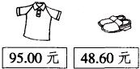

# Mathematics (Grade 6)

**ID**: 9019504f
**难度**: medium_hard
**题型**: short_answer

## 题目
（1）爸爸买2件上衣和1双鞋子一共花了多少元？
（2）1双鞋子比1件上衣便宜多少元？

## 解答

**答案**: 238.6, 46.4

1. Step1:先计算2件上衣的价钱，根据上衣单价95元，可得2件上衣价钱为95×2 = 190元
2. Step2:计算买2件上衣和1双鞋子的总花费，已知鞋子价格48.6元，将2件上衣的价钱190元与鞋子价格48.6元相加，即190 + 48.6 = 238.6元
3. Step3:计算1双鞋子比1件上衣便宜的金额，用上衣单价95元减去鞋子单价48.6元，即95 - 48.6 = 46.4元

## 知识点

**知识点**:
  - 图文应用题；整数、小数复合应用题．

---
