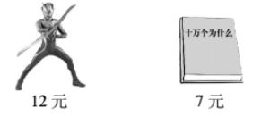

# Mathematics (Grade 6)

**ID**: 908e2177
**难度**: medium_hard
**题型**: short_answer

## 题目
淘气有16元钱，买下面两样东西，钱够不够？

## 解答

**答案**: 19, 16<19, 钱不够

1. Step1:计算两样东西的价格总和，12 + 7 = 19（元）
2. Step2:比较总价格19元和淘气有的16元的大小，得出16<19
3. Step3:根据比较结果判断钱是否够，得出钱不够

## 知识点

**知识点**:
  - 20以内数的大小比较;20以内数的不进位加法和不退位减法

---
