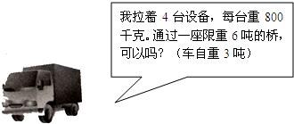

# Mathematics (Grade 6)

**ID**: 90b4504f
**难度**: medium_hard
**题型**: short_answer

## 题目

## 解答

**答案**: 不可以通过

1. Step1:计算4台设备的重量，800×4 = 3200（千克）
2. Step2:将4台设备重量的单位换算为吨，3200千克 = 3.2吨
3. Step3:计算车和设备的总重量，3.2 + 3 = 6.2（吨）
4. Step4:比较车和设备的总重量与桥的限重，6.2吨＞6吨
5. Step5:得出结论，不可以通过

## 知识点

**知识点**:
  - 整数、小数复合应用题．

---
